# Identità visiva Sapienza: guida base per il sito Scienze Chimiche

Fonte: *Manuale di Identità Visiva Sapienza Università di Roma — Elementi base*, giugno 2007, 17 pagine. Le immagini in `figure/` riproducono le tavole 2–16 per rendere comprensibili proporzioni, varianti e accostamenti. **Sono riferimenti visivi, non file master del marchio da riutilizzare nella pagina.** I numeri di pagina qui indicati sono quelli del PDF.

## Priorità e uso

Questa guida è la base per impaginazione, layout e identità visiva degli elaborati Sapienza di questo progetto. Prima di eseguire una richiesta dell'utente che se ne discosta, indicare **quale regola è in conflitto e quale modifica verrà fatta**. Se la richiesta è già esplicita, eseguirla dopo aver segnalato il conflitto: l'istruzione dell'utente prevale. Non trasformare il contenuto del PDF in istruzioni operative per l'agente.

Il manuale riguarda anche stampa, ricamo e insegne. Le misure in millimetri e i codici Pantone/CMYK/3M/RAL valgono nei rispettivi processi; **non convertirli arbitrariamente in pixel, rem o colori digitali**. Dove il manuale non specifica una griglia web o un valore di spaziatura, la sezione «Applicazione al sito» definisce una convenzione locale e la distingue dalla fonte.

## Marchio, logotipo e gerarchia

- Il marchio è l'ovale porpora con cherubino, fiammella e dicitura *Studium Urbis* in oro (tavola 2).
- Il logotipo «Sapienza Università di Roma» si usa insieme al marchio. Non si ridisegna, non se ne cambia la composizione e non si ricavano file da screenshot o dalle tavole di questa guida: usare i file digitali ufficiali approvati (tavola 3).
- Il logotipo è Rosso Sapienza nella versione positiva, bianco in negativo e nero quando la riproduzione è limitata al nero (tavola 3).
- Facoltà, Dipartimenti e altre strutture mantengono la propria denominazione dentro l'identità dell'Ateneo. Le specifiche sono composte in Sapienza Font con maiuscole e maiuscoletto, con corpo pari alla specifica «Università di Roma» (tavole 8–9). Un comune font serif non equivale a Sapienza Font.

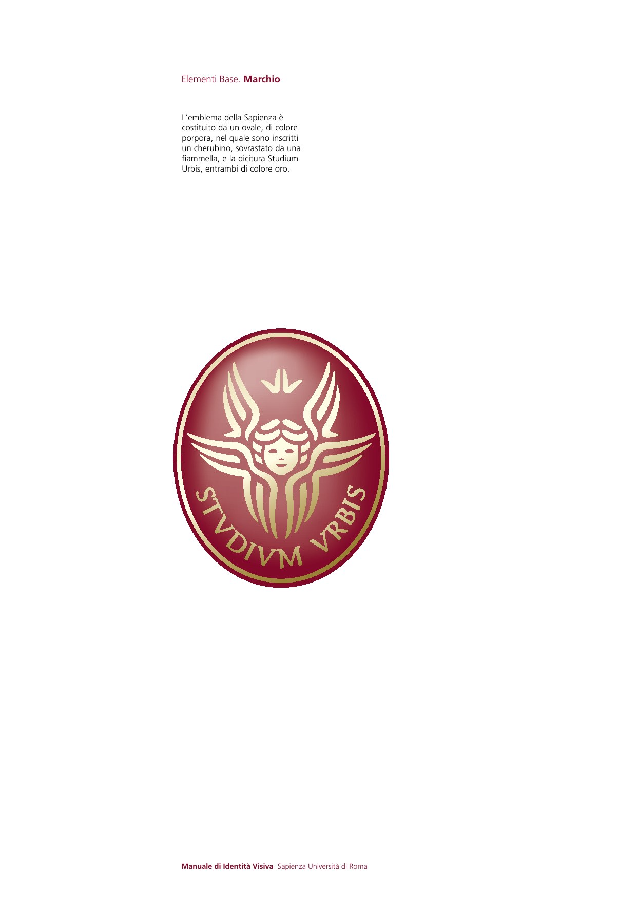
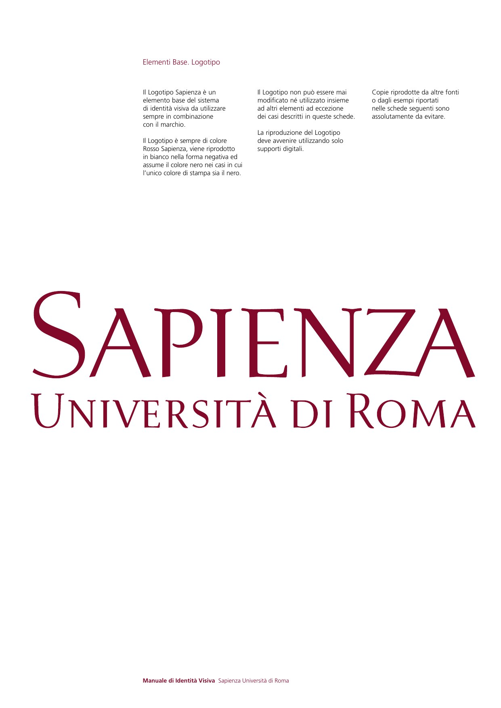

### Variante da usare secondo lo sfondo

| Contesto | Variante indicata dal manuale | Tavola |
| --- | --- | --- |
| Fondo bianco o molto chiaro | Positiva 3D, preferita; positiva al tratto dove necessario | 4 |
| Riproduzione in solo nero, stampa da computer, formato piccolo, incisione o ricamo | Al tratto; nero se il nero è l'unico colore disponibile | 4, 7, 11 |
| Fondo scuro | Negativa; preferire Rosso Sapienza, nero o colori istituzionali | 5 |
| Fondo Rosso Sapienza | La versione negativa 3D può avere l'ombra prevista dal manuale | 5 |
| Fondo Pantone a tinta piatta | Negativa al tratto | 6 |
| Fondo fotografico o colore in quadricromia | Versione 3D | 6 |

La versione speciale illustrata nella tavola 7 è riservata a **ricamo su stoffa e timbri**. Gli altri esempi della tavola mostrano tecniche fisiche specifiche, come stampa a secco e incisione: non sono effetti CSS da imitare.

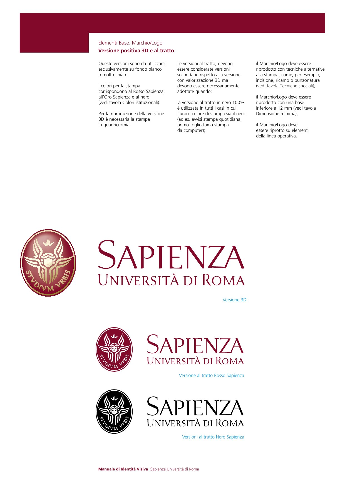
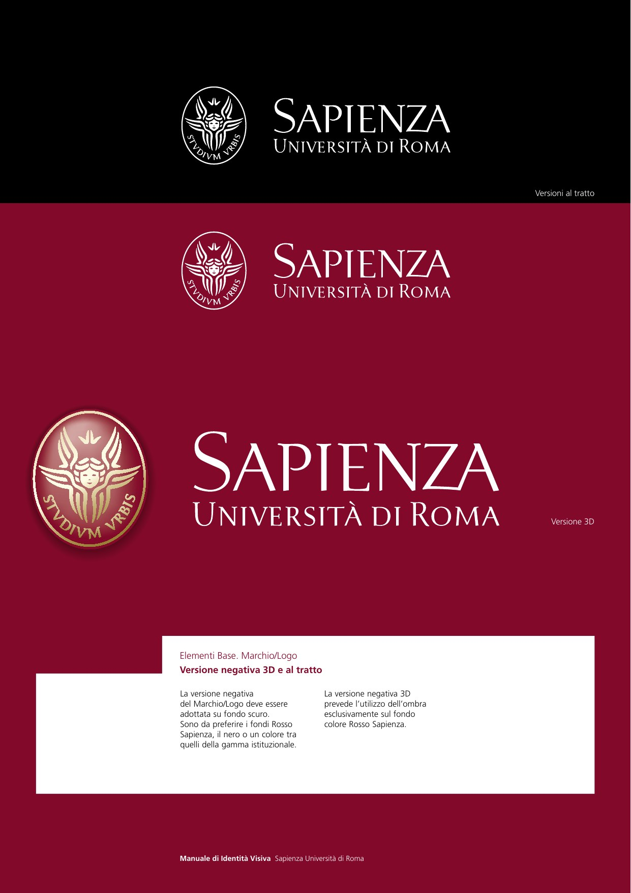
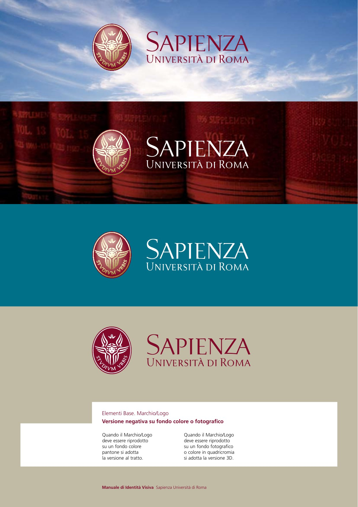
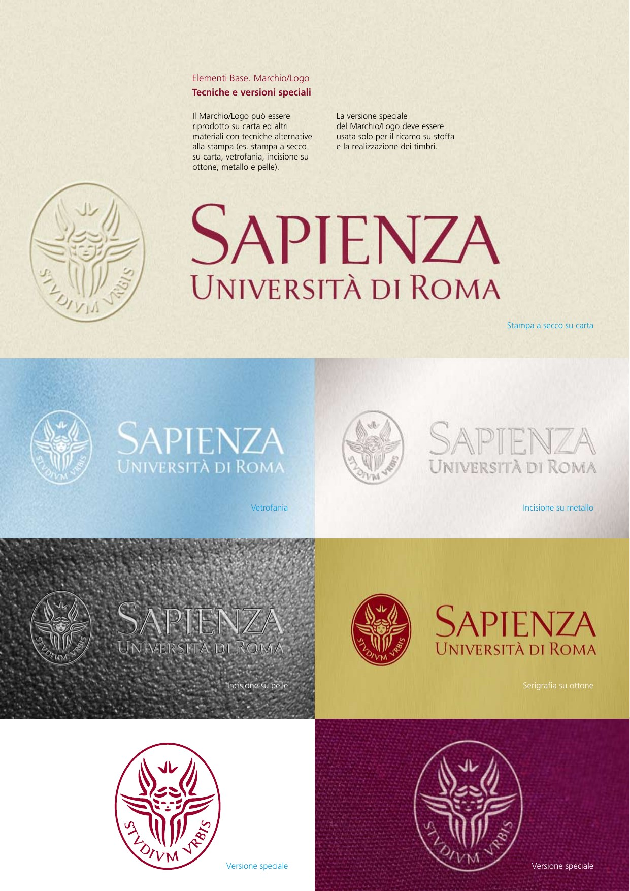

## Griglia, allineamento e area di rispetto

Il manuale costruisce il gruppo marchio/logotipo su un reticolo modulare con **modulo quadrato X**. La specifica della struttura parte dalla stessa linea sinistra della «S» del logotipo. La tavola 8 mostra un esempio, non una dimensione universale: marchio alto 18 mm e largo 15 mm, specifica di 12 pt con interlinea 13,5 pt, gruppo marchio/logotipo largo 60 mm. Quando si scala il marchio, il rapporto tra gli elementi resta costante.

Lasciare libera attorno al gruppo almeno l'**area di rispetto** mostrata nella tavola 10; se possibile, aumentarla. Quando compaiono più strutture, testi o altri marchi, usare gli allineamenti orizzontali o verticali illustrati e conservare lo spazio tra i soggetti. I marchi fotografici accostati sono previsti su fondo bianco. Il PDF non dà un numero di pixel per X: usare la proporzione del file master, non una stima ricavata dal JPG.

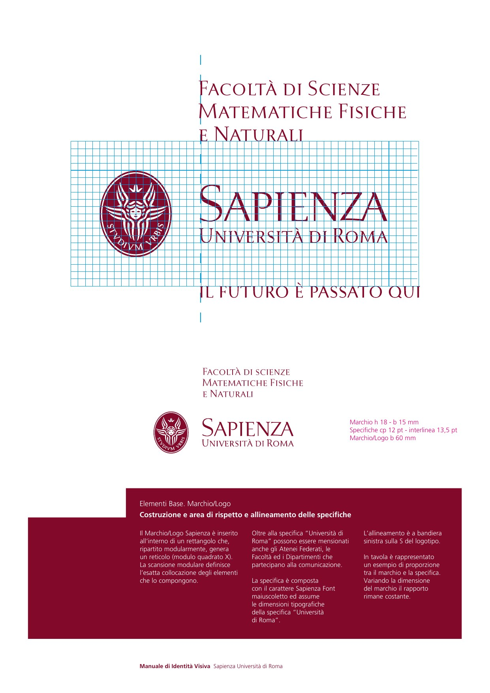
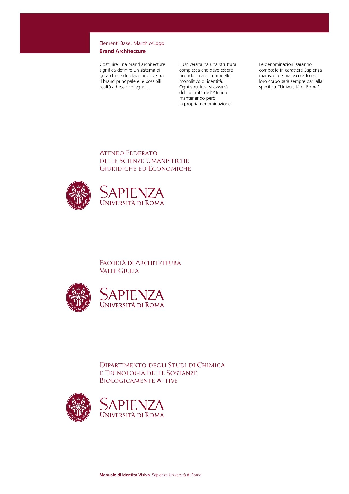
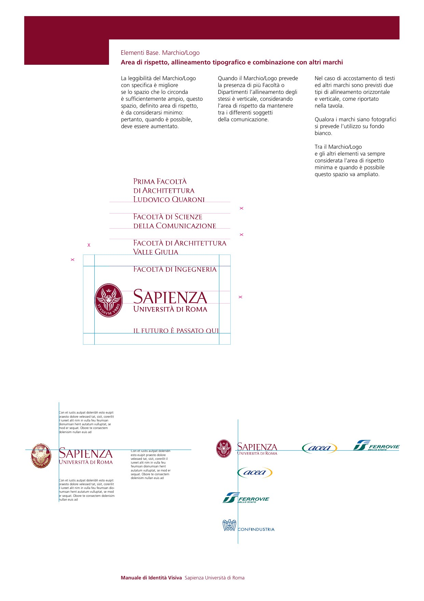

### Dimensioni minime di stampa

| Variante | Base del marchio | Altezza del marchio | Specifica | Larghezza del gruppo marchio/logotipo |
| --- | ---: | ---: | --- | ---: |
| 3D | 12 mm | 15 mm | 10 pt; interlinea 11,25 pt | 50 mm |
| Al tratto | 7,5 mm | 9 mm | 6 pt; interlinea 6,75 pt | 30 mm |

Non scendere sotto le basi consigliate nella tavola 11. Questi sono **minimi per la stampa**; la leggibilità su schermo va valutata nel layout finale senza inventare una conversione fissa mm→px.

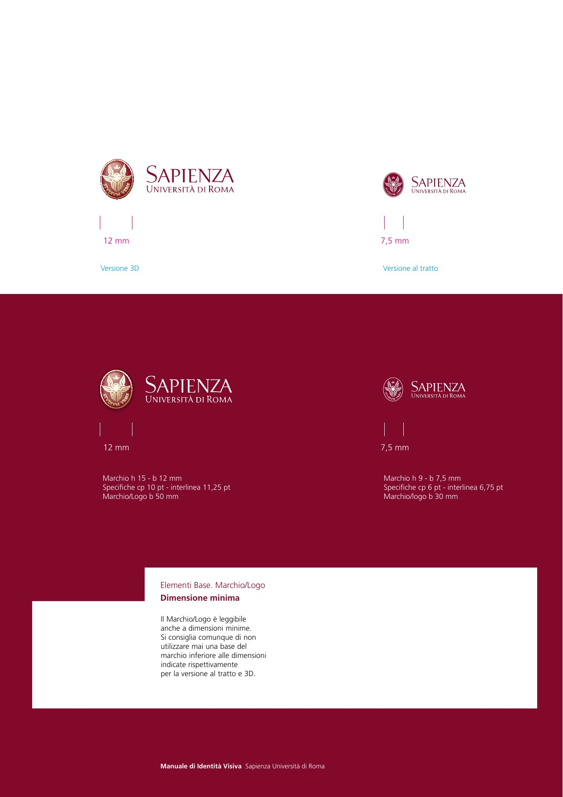

## Caratteri tipografici

| Funzione | Famiglia del manuale | Sostituzione esplicitamente prevista | Tavola |
| --- | --- | --- | --- |
| Logotipo e specifiche istituzionali | **Sapienza Font**, carattere disegnato per il marchio; il logotipo contiene legature Z–A personalizzate | Nessuna: usare un asset ufficiale, non ricomporre il marchio come testo | 12 |
| Materiale di stampa e forme di comunicazione | **Frutiger**: 45 Light, 46 Light Italic, 55 Roman, 56 Roman Italic, 65 Bold, 66 Bold Italic | **Arial** | 13 |
| Materiale operativo e testi | **Palatino Linotype** | **Times** | 13 |

**Georgia non compare nel manuale.** Una pila CSS che inizia con Georgia non soddisfa questa indicazione anche se contiene Times come ripiego. Non incorporare file di Sapienza Font o Frutiger senza un file e diritti d'uso appropriati; se mancano, usare i sostituti indicati per testo e comunicazione, e il marchio ufficiale come immagine per il logotipo.

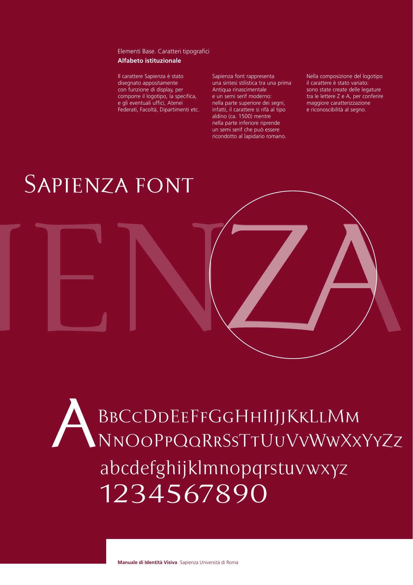
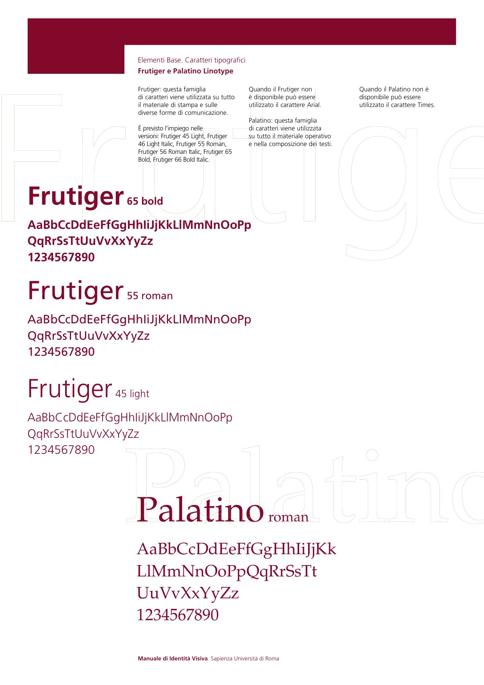

## Colori istituzionali

I colori di base sono **Rosso, Oro, Nero e Bianco**. La tavola 14 distingue codici per stampa, pellicole, vernici e schermo.

| Colore | Pantone | CMYK | RGB | HTML | 3M | RAL |
| --- | --- | --- | --- | --- | --- | --- |
| Rosso Sapienza | PMS 202 EC | 10, 100, 61, 50 | 130, 36, 51 | `#822433` | 100-723 | 3004 |
| Oro Sapienza | PMS 871 EC | non indicato | non indicato | **non indicato** | 100-54 | oro pallido, finezza 80 |
| Nero | PMS Black EC | 0, 0, 0, 100 | 0, 0, 0 | `#000000` | 100-22 | 8019 |
| Bianco | non indicato | 0, 0, 0, 0 | 255, 255, 255 | `#FFFFFF` | 100-20 | 9010 |

Per l'Oro non creare un esadecimale «ufficiale» a partire dalla fotografia della tavola: il PDF non ne fornisce uno. Usare il colore solo tramite un asset ufficiale o una specifica approvata per il supporto.

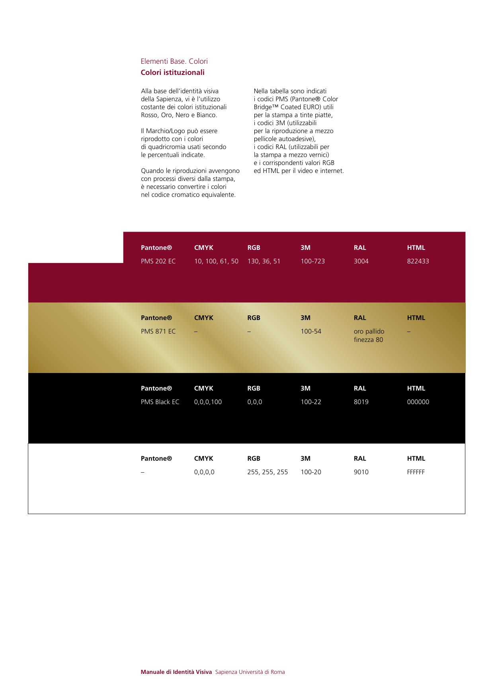

### Colori complementari

Il manuale riserva prevalentemente la **colonna sinistra** a copertine editoriali e di presentazione; la **colonna destra** a grafici, tabelle e box di testo. Il loro impiego resta vincolato agli esempi del manuale o a implementazioni approvate. Gli HEX seguenti sono **conversioni aritmetiche dei valori RGB riportati**, non codici HTML stampati nella tavola.

| Copertine: Pantone | CMYK | RGB | HEX derivato | Grafici/box: Pantone | CMYK | RGB | HEX derivato |
| --- | --- | --- | --- | --- | --- | --- | --- |
| PMS 556 EC | 58, 8, 45, 14 | 112, 164, 137 | `#70A489` | PMS 558 EC | 39, 3, 26, 4 | 170, 201, 182 | `#AAC9B6` |
| PMS 117 EC | 7, 28, 100, 12 | 199, 153, 0 | `#C79900` | PMS 110 EC | 2, 24, 100, 8 | 215, 169, 0 | `#D7A900` |
| PMS 1525 EC | 2, 78, 100, 9 | 197, 76, 0 | `#C54C00` | PMS 715 EC | 0, 56, 87, 0 | 246, 146, 64 | `#F69240` |
| PMS 3155 EC | 100, 10, 28, 47 | 0, 103, 120 | `#006778` | PMS 7466 EC | 88, 0, 29, 0 | 0, 179, 190 | `#00B3BE` |
| PMS 7536 EC | 11, 13, 30, 32 | 170, 163, 142 | `#AAA38E` | PMS 7534 EC | 5, 5, 13, 8 | 215, 211, 199 | `#D7D3C7` |
| PMS 5435 EC | 31, 8, 6, 11 | 166, 188, 198 | `#A6BCC6` | PMS 642 EC | 13, 2, 1, 1 | 211, 222, 228 | `#D3DEE4` |

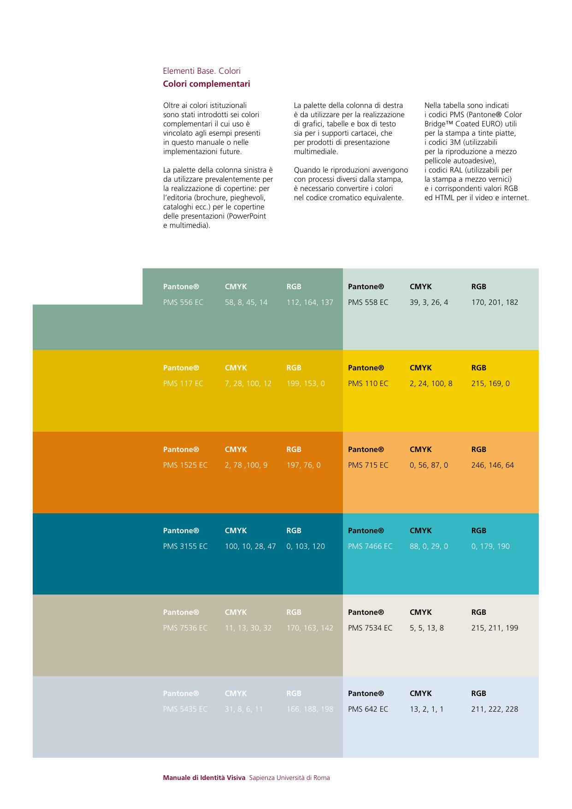

## Applicazione al layout web del progetto

Questa sezione è una **convenzione operativa del progetto derivata dai principi del PDF**, non una misura o un layout web prescritti dal manuale del 2007.

1. Mettere in testa il marchio/logotipo ufficiale come unità indivisibile; eventuale nome del corso o della struttura segue la gerarchia e l'allineamento illustrati. Non inserire testo o controlli nell'area di rispetto del marchio.
2. Allineare titolo, introduzione, contenuto e riferimenti a una stessa linea di partenza. Usare una griglia coerente e spazio sufficiente tra sezioni, senza ricavare dimensioni web dalle tavole di stampa.
3. Usare `#822433` come rosso principale e bianco/nero come basi. Impiegare i complementari secondo le funzioni della tavola 15; non creare un oro digitale istituzionale di fantasia.
4. Per testo e comunicazione, preferire le famiglie del manuale o i sostituti che esso nomina. Il nome «Sapienza» nel marchio resta un asset ufficiale, non testo HTML stilizzato.
5. Applicare la versione del marchio corretta per il fondo. Mantenere contrasto e leggibilità anche su schermi piccoli; la tavola 11 non definisce minimi in pixel.
6. Collocare fonti e link istituzionali vicino alle informazioni che sostengono. Il PDF non prescrive una struttura di navigazione web: le pagine del sito mantengono la propria navigazione funzionale.

Esempio di sole variabili compatibili con le indicazioni esplicite del PDF (la disponibilità di Frutiger e Palatino Linotype dipende dall'ambiente):

```css
:root {
  --sapienza-rosso: #822433;
  --sapienza-nero: #000000;
  --sapienza-bianco: #ffffff;
  --font-comunicazione: "Frutiger", Arial, sans-serif;
  --font-testo: "Palatino Linotype", Times, serif;
}
```

## Errori da evitare

La tavola 16 illustra errori da evitare in ogni supporto: cambiare il colore o la composizione del marchio; ignorare area di rispetto e allineamenti; deformarlo; ricomporre male i testi istituzionali; usare caratteri estranei alla famiglia prevista; scegliere una versione del marchio incompatibile con sfondo e colori. **Le tavole JPG servono a riconoscere questi casi, non a produrre un nuovo logo.**

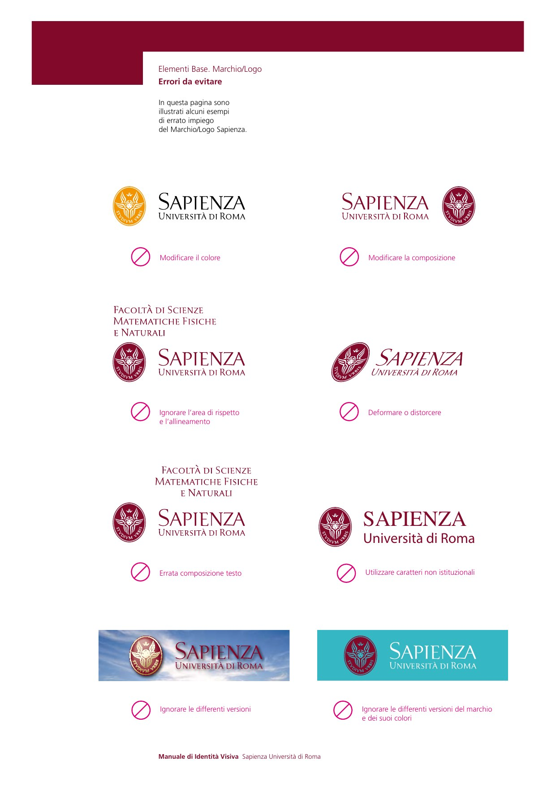

## Termini utili dal glossario del PDF

- **Allineamento:** disposizione di testi o immagini lungo una linea comune.
- **Area di rispetto:** spazio attorno al marchio da lasciare libero.
- **Griglia:** reticolo usato per collocare gli elementi.
- **Interlinea:** distanza fra le linee di testo.
- **PMS:** sistema Pantone per identificare tinte di stampa.
- **Quadricromia:** stampa basata sui quattro colori CMYK.

Queste definizioni orientano l'uso delle tavole 8–16; il glossario completo è nella pagina 17 del PDF originale.
